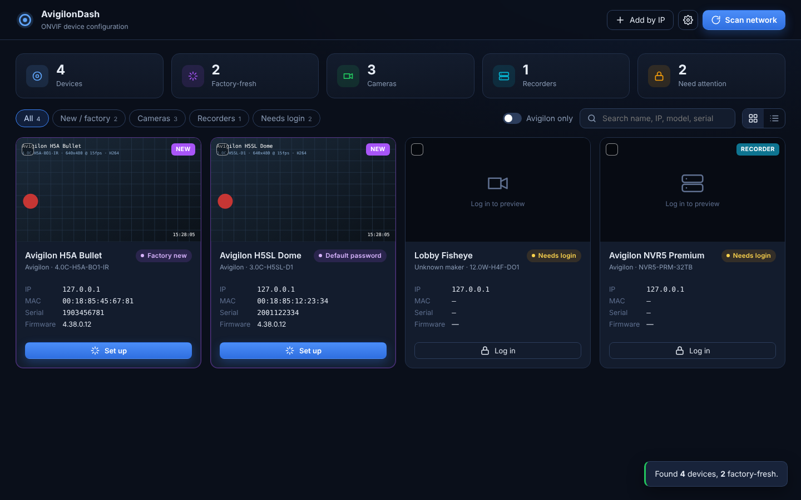
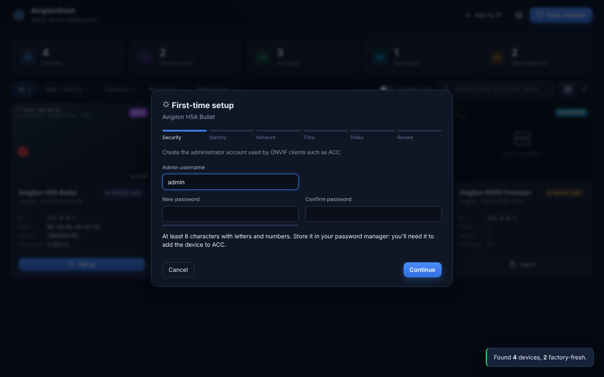
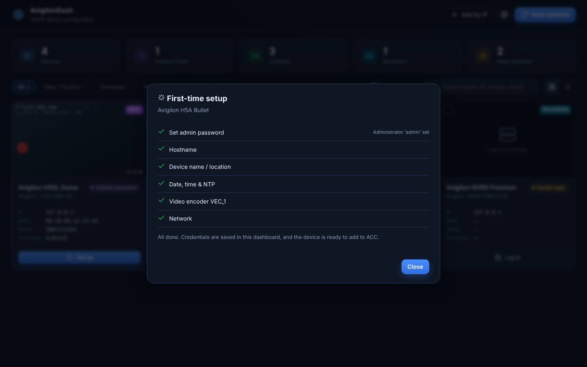
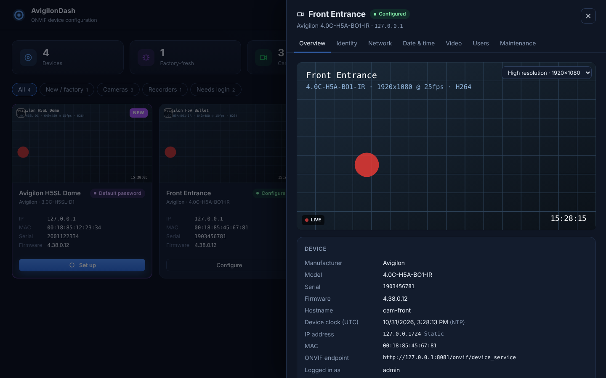
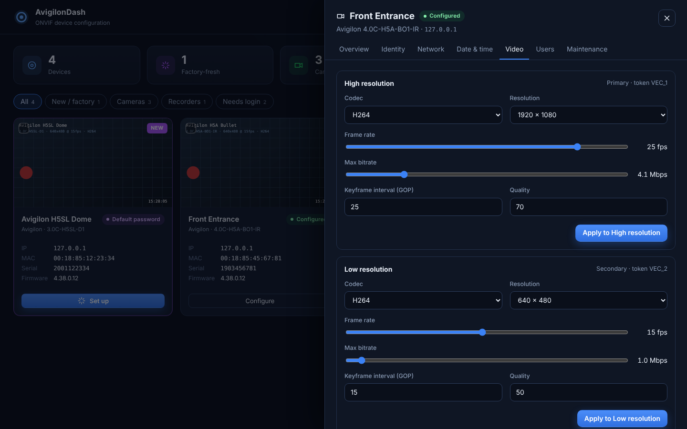
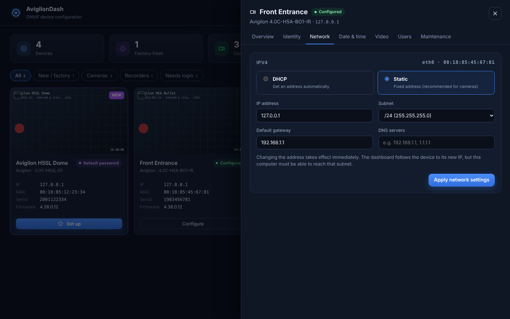

<div align="center">

# 🎥 AV Finder Tool

**Find, secure and configure Avigilon cameras and recorders straight out of the box, over ONVIF.**

A local web dashboard (the app is called **AvigilonDash**) for installers commissioning Avigilon devices.
Plug the devices in, press **Scan**, and set them up one at a time or a whole batch at once.




</div>

---

## Contents

- [Why](#why)
- [Features](#features)
- [Screenshots](#screenshots)
- [Quick start](#quick-start)
- [Commissioning factory-fresh devices](#commissioning-factory-fresh-devices)
- [Try it without hardware](#try-it-without-hardware)
- [How it works](#how-it-works)
- [Troubleshooting](#troubleshooting)
- [Security notes](#security-notes)

## Why

Out of the box, Avigilon devices sit on DHCP or a `169.254.x.x` link-local address with no ONVIF account, or with a default
password. Getting each one onto a proper address, with a strong password and correct time, usually means opening a web page
per camera. AV Finder Tool does all of that from one screen, over standard ONVIF.

## Features

| | |
|---|---|
| 🔍 **Discovery** | ONVIF WS-Discovery multicast out of every network card, plus an optional unicast sweep of routed subnets. Add a device by IP when discovery can't reach it. |
| ✨ **Factory-fresh detection** | A purple **NEW** tag marks devices with **no ONVIF users** (ONVIF factory default state) or a **default password**. Devices on a **link-local** address are flagged too. |
| 🧙 **First-time setup wizard** | Admin account → name, hostname and location → static IP or DHCP → NTP and time zone → main stream resolution, fps and bitrate → review → apply. |
| 📦 **Batch setup** | Tick several devices and set them all up at once, with sequential IPs and hostnames (`cam-01`, `cam-02`…). |
| 📺 **Live preview** | Snapshot preview that refreshes every 2 seconds, plus copy-ready RTSP stream addresses for each profile. |
| ⚙️ **Full configuration** | Identity, network (IP, subnet, gateway, DNS), date and time, video encoders per profile, ONVIF users, reboot, soft or hard factory reset. |
| 🗂️ **Cameras and recorders** | Recorders (NVRs, appliances) are recognised and listed separately. Filter by new, cameras, recorders or needs login, or search by name, IP, model, serial or MAC. |
| 🧪 **Built-in simulator** | Four virtual Avigilon devices so you can try everything without hardware. |

## Screenshots

<table>
<tr>
<td width="50%"><br><sub><b>First-time setup wizard</b>: secure a new device in six short steps.</sub></td>
<td width="50%"><br><sub><b>Setup results</b>: every step is reported, so you can see exactly what was applied.</sub></td>
</tr>
<tr>
<td><br><sub><b>Device panel</b>: live preview, device details and stream addresses.</sub></td>
<td><br><sub><b>Video settings</b>: codec, resolution, frame rate, bitrate and GOP for each profile.</sub></td>
</tr>
<tr>
<td><br><sub><b>Network settings</b>: switch between DHCP and static addressing.</sub></td>
<td></td>
</tr>
</table>

## Quick start

You need **Python 3.10 or newer** on a computer that's on the same network as the devices.

```bash
git clone https://github.com/Rikkicmd/AV-Finder-Tool.git
cd AV-Finder-Tool
```

| Windows | macOS / Linux |
|---|---|
| Double-click **`run.bat`** | `./run.sh` |

Then open **http://localhost:8000**. The first launch creates a `.venv` folder and installs the dependencies, so it takes a
minute. Later launches start instantly.

<details>
<summary>Manual install</summary>

```bash
python -m venv .venv
. .venv/bin/activate            # Windows: .venv\Scripts\activate
pip install -r requirements.txt
uvicorn app.main:app --port 8000
```
</details>

By default the dashboard only listens on `127.0.0.1`. Set `HOST=0.0.0.0` before `./run.sh` to open it to other machines,
but note the dashboard itself has no login.

## Commissioning factory-fresh devices

1. **Connect** the cameras or recorders to the same switch as your computer.
2. **Addresses.** With no DHCP server on the network, Avigilon devices fall back to a `169.254.x.x` address. Windows and
   macOS do the same when there's no DHCP, so a laptop plugged straight into the switch just works. Otherwise add a second
   IP such as `169.254.1.1/16` to your network card, or put a DHCP server on the camera network.
3. **Scan.** Press **Scan network**. New devices show the purple **NEW** tag:
   - *Factory new*: no ONVIF users yet, so anyone on the network can change it until it's set up.
   - *Default password*: a password from **Settings → Default credentials** worked.
4. **Set up.** Click **Set up** on a device, or tick several cards and click **Set up selected**. Network changes are applied
   last so the device stays reachable during setup, and the dashboard follows each device to its new address.
5. **Add to ACC.** Add the devices to Avigilon Control Center with the admin account you set.

Devices that are already secured show **Needs login**. Click **Log in** and enter an ONVIF account. On Avigilon cameras,
ONVIF users are managed on the camera's web page or in ACC.

> **Recorders:** Avigilon NVRs and appliances run ACC Server. Over ONVIF they expose identity, network, time and users;
> cameras and recording schedules are still configured in ACC.

## Try it without hardware

The simulator starts four virtual Avigilon devices:

| Device | Port | State |
|---|---|---|
| H5A bullet | 8081 | Factory new (no users) |
| H5SL dome | 8082 | Default password `admin` / `admin` |
| H4 fisheye | 8083 | Secured, `admin` / `Secure123!` |
| NVR5 recorder | 8084 | Secured, `admin` / `Secure123!` |

```bash
python -m simulator.fake_devices      # terminal 1
./run.sh                              # terminal 2
```

If multicast doesn't loop back on your machine, add `127.0.0.1/32` under **Settings → Extra subnets to sweep**.

## How it works

```
Browser (static/)  ──REST──▶  FastAPI (app/main.py)  ──SOAP/HTTP──▶  ONVIF devices
                                    │                 ◀──UDP 3702──  WS-Discovery
                                    └── data/*.json (inventory + settings)
```

| Piece | File |
|---|---|
| ONVIF SOAP client with WS-Security digest auth, HTTP Digest fallback and clock-skew correction | [`app/onvif.py`](app/onvif.py) |
| WS-Discovery multicast probe on every NIC, plus unicast sweep | [`app/discovery.py`](app/discovery.py) |
| REST API, device assessment, setup wizard and batch setup | [`app/main.py`](app/main.py) |
| Device inventory and settings, stored as JSON in `data/` | [`app/store.py`](app/store.py) |
| Web interface: plain HTML, CSS and JS with no build step | [`static/`](static/) |
| Virtual Avigilon devices for testing | [`simulator/fake_devices.py`](simulator/fake_devices.py) |

**How device state is worked out.** After discovery, each device is checked in this order:

1. `GetSystemDateAndTime` (no login needed) checks it's reachable and measures its clock offset, so login digests stay valid
   even when the device clock is wrong.
2. `GetUsers` without a login. If it succeeds and returns no users, the device is in the ONVIF **factory default state**.
3. Saved credentials, then each pair from the **Default credentials** list.
4. If nothing works, the device is marked **Needs login**.

<details>
<summary>ONVIF operations used</summary>

**Device service:** `GetDeviceInformation`, `GetServices`, `GetCapabilities`, `GetScopes`, `SetScopes`, `GetHostname`,
`SetHostname`, `GetNetworkInterfaces`, `SetNetworkInterfaces`, `GetNetworkDefaultGateway`, `SetNetworkDefaultGateway`,
`GetDNS`, `SetDNS`, `GetNTP`, `SetNTP`, `GetSystemDateAndTime`, `SetSystemDateAndTime`, `GetUsers`, `CreateUsers`,
`SetUser`, `DeleteUsers`, `SystemReboot`, `SetSystemFactoryDefault`

**Media service:** `GetProfiles`, `GetVideoEncoderConfiguration`, `SetVideoEncoderConfiguration`,
`GetVideoEncoderConfigurationOptions`, `GetStreamUri`, `GetSnapshotUri`
</details>

## Troubleshooting

| Symptom | Fix |
|---|---|
| Scan finds nothing | Check your firewall allows UDP 3702 in and out. On routed networks multicast won't cross subnets, so add the subnet under **Settings → Extra subnets to sweep** or use **Add by IP**. |
| Device found but every action fails | It's probably on `169.254.x.x` and your computer isn't. Give your network card an address in that range. |
| **Needs login** on a brand-new camera | Newer firmware may need the first password set on the camera's web page. Do that, then click **Log in**. |
| A video setting is rejected | The camera doesn't support that resolution or frame rate for that codec. The dropdowns list what the camera reports. |
| Device disappears after changing its IP | Your computer can't reach the new subnet. Add an address on that subnet, then rescan. |

## Security notes

- Device passwords are stored **in plain text** in `data/devices.json` so the dashboard can keep talking to the devices.
  Keep the folder private, or delete it once commissioning is done. It's already in `.gitignore`.
- The dashboard has no login of its own and listens on localhost only by default.
- ONVIF traffic is plain HTTP, as on most cameras. Commission devices on a trusted network.
